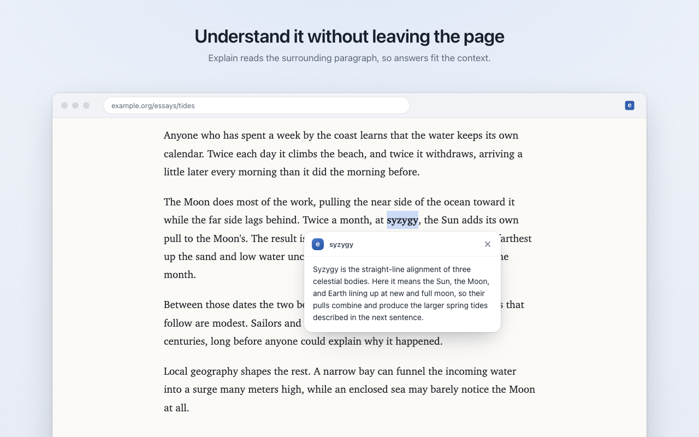

<p align="center"></p>

<h1 align="center">Explain</h1>

<p align="center">Select text, right-click, choose <b>Explain</b>.<br>A short, plain answer streams in right beside it.</p>

<p align="center"><a href="https://explain.menzo.dev">Website</a> · <a href="https://github.com/canmenzo/explain/releases/latest">Download</a> · <a href="PRIVACY.md">Privacy</a></p>

<p align="center"></p>

## Install

1. Download `explain-chrome.zip` from the [latest release](https://github.com/canmenzo/explain/releases/latest) and unzip it.
2. Open `chrome://extensions`, turn on **Developer mode**, click **Load unpacked** and pick the folder.
3. Click the Explain icon, follow **Get a free key** to Google AI Studio, paste the key and save.

Firefox 140+: load `manifest.json` from `explain-firefox.zip` in `about:debugging#/runtime/this-firefox`.

## Update

Copies installed from the zip check GitHub for a new release when you open the popup. When one is out, download the new zip, unzip it over your Explain folder and click **Reload Explain** in the notice. Your key is kept.

## Privacy

Only the selection, the paragraph around it and the page title go to Google's Gemini API, straight from your browser. No servers, no account, no analytics. Your key is saved in this browser only, never synced. On Google's free tier, Google may use requests to improve its products.

## Develop

Needs Node.js 20+ and Rust with the `wasm32-unknown-unknown` target.

```sh
npm run build   # Rust core to WebAssembly, then dist/chrome.zip and dist/firefox.zip
npm test        # Rust unit tests and extension tests
```

The Rust core validates selections, builds Gemini requests and parses the streamed replies. JavaScript handles the browser side: the menu, the card and the network.

## License

[MIT](LICENSE)
